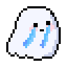
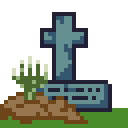
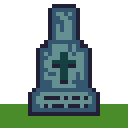
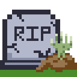
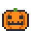
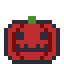
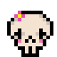
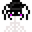

<div align="center">


# Ghostlet

**Step away from your PC. Tiny ghosts move in.** 👻

[](https://hacktoberfest.com/)


</div>

Leave your mouse alone for a minute and pixel ghosts float up around your cursor, while pumpkins, graves and spooky friends pile up along the bottom of your screen. Come back and they panic, grab the decorations and run away! 🎃

## 👻 Meet the ghosts

Each ghost picks a random look.

<div align="center">

|  |  |  |
|:-:|:-:|:-:|
| classic | cool | crying |
|  |  |  |
| hunting | loving | magic |
|  |  |  |
| peeping | shivering | sleeping |


✨ **The rare one!** 10× less likely to show up than any other ghost. ✨

</div>

## 🎃 Spooky props

<div align="center">

|  |  |  |  |
|:-:|:-:|:-:|:-:|
| cross grave | tall grave | wide grave | short grave |
|  |  |  |  |
| pumpkin | red pumpkin | skeleton | spider |

The longer you're away, the more pile up. When you're back, the ghosts carry them off.

</div>

## 💾 Get it

Grab `Ghostlet.exe` from [Releases](https://github.com/ashtonckj/ghostlet/releases) and double-click it. No Python needed.

Ghostlet lives in your tray (bottom-right). Right-click the ghost for **Settings**.

<details>
<summary>Run from source or build the exe</summary>

```powershell
pip install -r requirements-dev.txt
python run_ghostlet.py
python -m PyInstaller ghostlet.spec
```

The last line builds `dist\Ghostlet.exe`. Exit Ghostlet from the tray first, or Windows won't let it overwrite the running file.

</details>

## ✨ Good to know

- 🖱️ Clicks go straight through the ghosts, and they never steal focus.
- 🎚️ Settings: up to 10 ghosts, size, opacity and idle time. **Test spawn** shows them right away.
- 🔒 No accounts, no telemetry. The only network use is an update check on GitHub, with one checkbox to turn it off. See [SECURITY.md](SECURITY.md).
- 🎨 Add your own ghosts and props by dropping a PNG in a folder, no code. See the [art guide](ghostlet/assets/README.md).

## 💜 Contributing

Pixel art, ideas and PRs are welcome! Start with [CONTRIBUTING.md](CONTRIBUTING.md). Licensed under [MIT](LICENSE).
